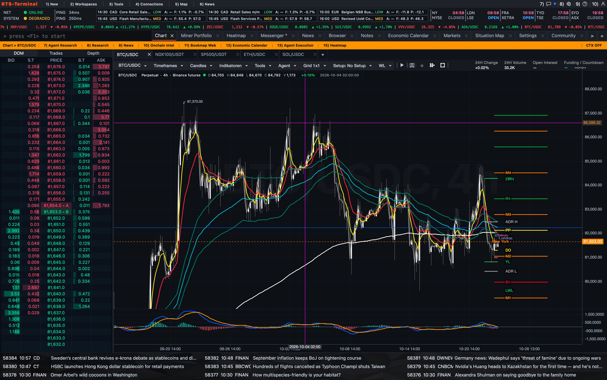
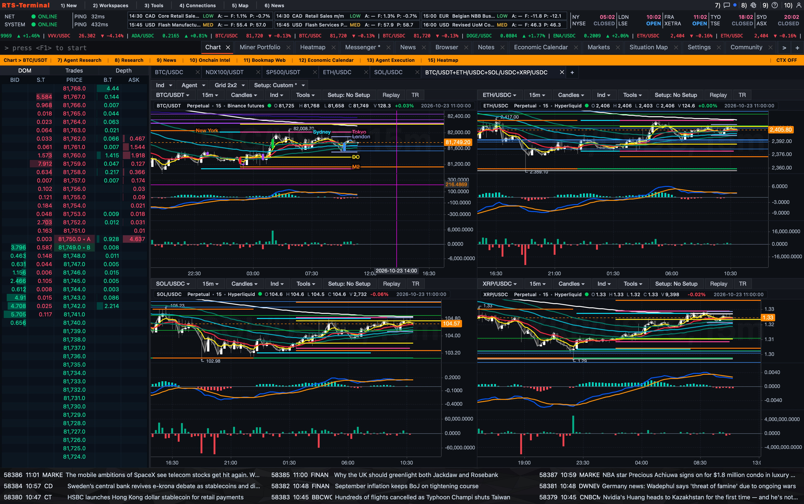
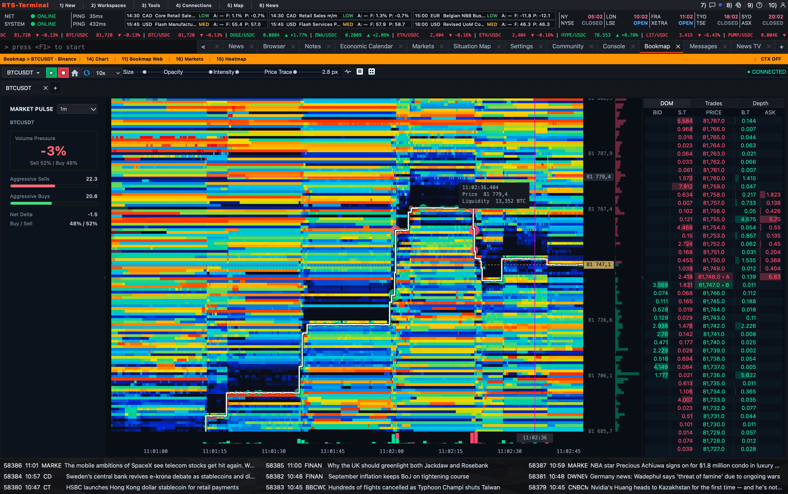
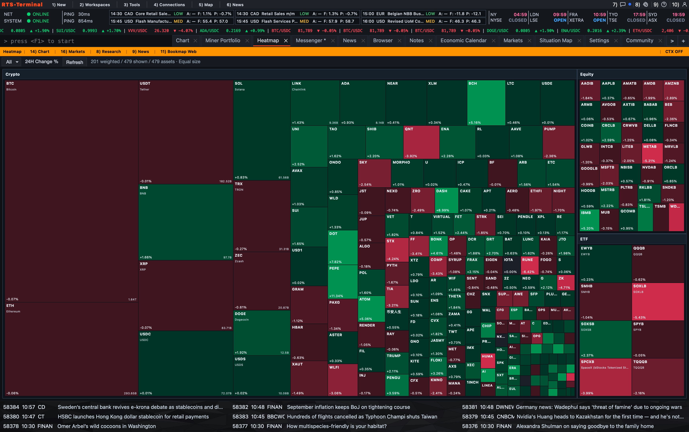
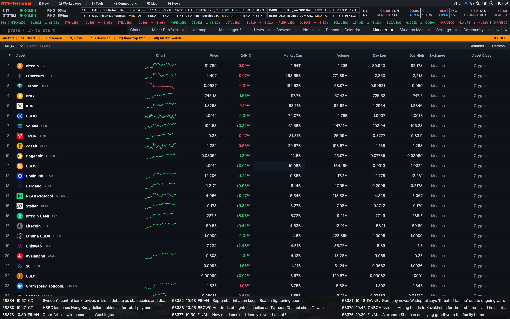
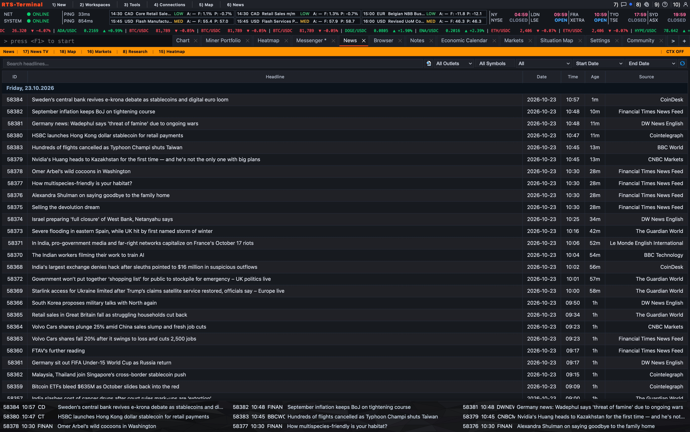
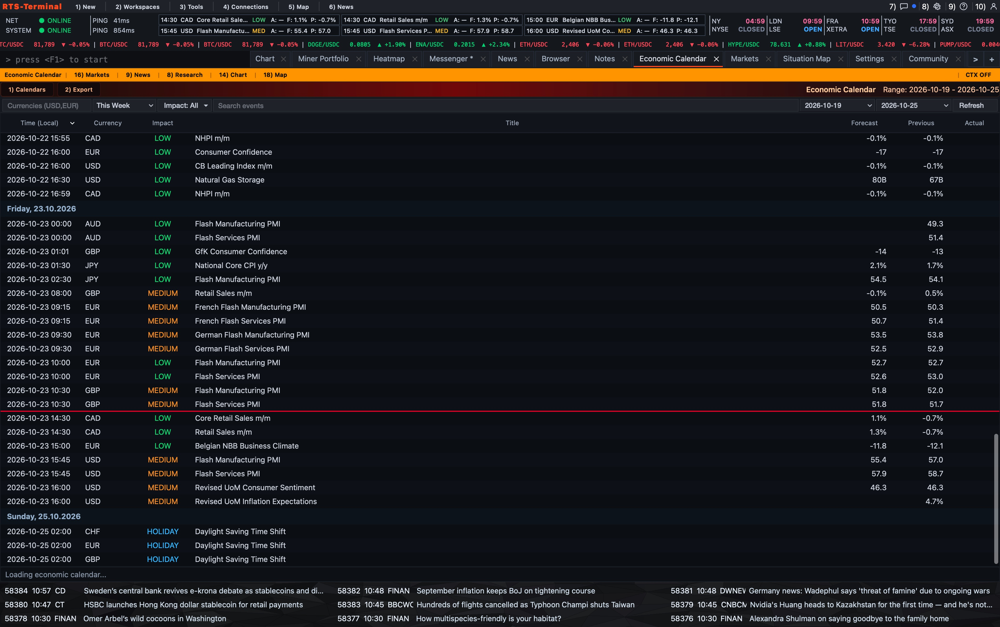
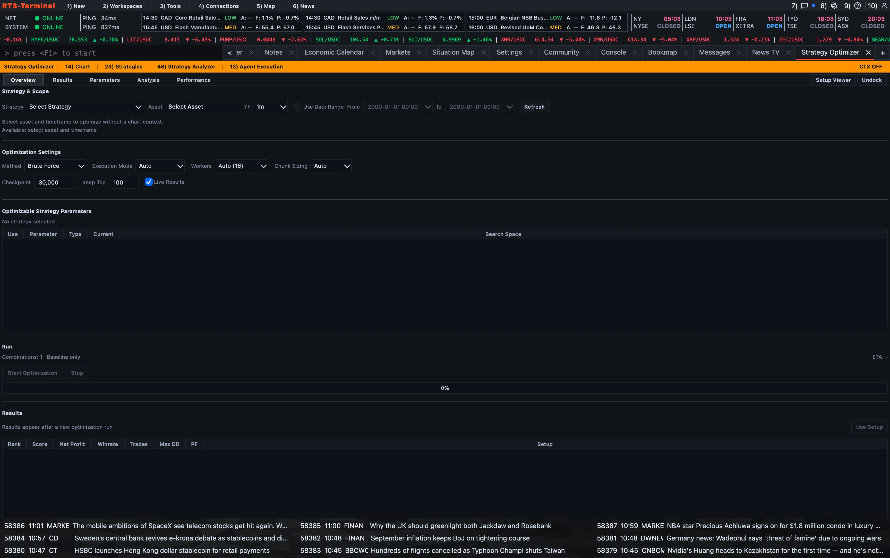
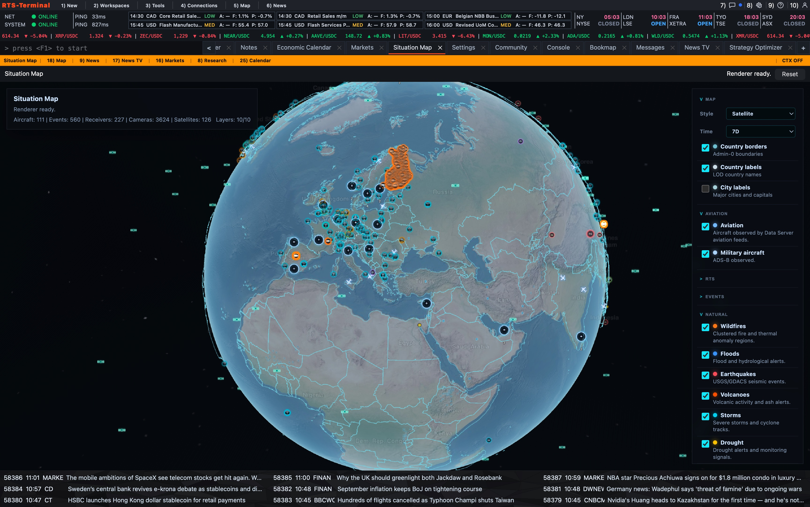
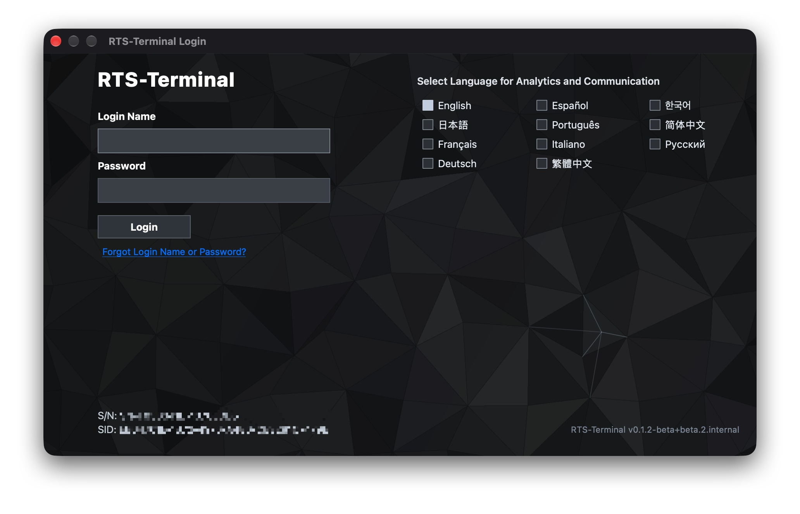

# RTS Terminal

**A modern, modular trading and financial analytics platform.**

[🌐 Official Website – RTS Systems](https://www.rts-systems.com)

RTS Terminal is an independently developed desktop application designed to bring market analysis, trading workflows, portfolio monitoring, and financial analytics into a unified environment.

The project focuses on combining a professional trading interface with a flexible, modular architecture and a self-hosted backend infrastructure.

## Key Features

- **Advanced Charting** – Interactive financial charts with technical indicators, multiple chart panels, and customizable layouts.
- **Technical Analysis** – Tools for analyzing market trends, price movements, volume, and momentum.
- **Portfolio & Performance Analytics** – Financial performance tracking and interactive visualizations.
- **Mining Portfolio Tracking (MPORT)** – Tools for monitoring Bitcoin mining rewards, costs, and performance.
- **Modular Connectivity** – Connection-package architecture for integrating external trading services and market data providers.
- **Authentication & Access Control** – Backend-supported authentication, session management, and role-based permissions.
- **Customizable Interface** – A desktop-oriented workspace with multiple visualization and interface options.
- **Market Intelligence** – Integrated market data, financial news, economic calendars, and market heatmaps.
- **Order Flow Analysis** – Liquidity visualization and depth-of-market monitoring.
- **Global Situation Awareness** – Geographic visualization of aviation activity, natural events, and global developments.

## Architecture

RTS Terminal is supported by a distributed backend architecture with dedicated services for authentication, data processing, and application updates.

The infrastructure incorporates Python, Docker, Kubernetes, PostgreSQL, Redis, and HTTPS/WSS communication.

## Project Status

**Active Development**

RTS Terminal is continuously being developed, tested, and improved. Some capabilities are experimental or not yet production-ready.

## Availability & Beta Testing

**RTS Terminal is currently available exclusively for macOS.**

The application is still under active development, and access is currently limited to beta testing.

We welcome individuals interested in testing RTS Terminal, exploring its capabilities, and providing feedback to help improve the platform.

**Interested in becoming a beta tester?**

Contact us at **[office@rts-systems.com](mailto:office@rts-systems.com)** with the subject **RTS Terminal – Beta Testing Request**.

Beta testing access is subject to availability and approval.

## Vision

The long-term goal is to build an independent, extensible trading ecosystem that combines professional market analysis, trading infrastructure, and financial management within a consistent desktop experience.

RTS Terminal is developed as part of the broader RTS ecosystem.

---

## Screenshots

The following screenshots showcase different components of the RTS Terminal desktop application.

### Advanced Charting

Professional charting workspace with technical indicators and market analysis tools.

### Multi-Chart Workspace

Analyze multiple financial instruments simultaneously.

### Order Flow & Liquidity

Real-time liquidity heatmap and order book visualization.

### Market Heatmap

Visual overview of market movements and asset performance.

### Market Overview

Market data, asset statistics, and price trends.

### Financial News

Integrated financial news and market headlines.

### Economic Calendar

Macroeconomic events, forecasts, and market impact indicators.

### Strategy Optimizer

Strategy parameter optimization and performance analysis tools.

### Global Situation Map

Interactive 3D globe with aviation, environmental, and global event data.

### Authentication

Multilingual login interface with backend-supported authentication.

---

## Links

- **Official Website:** https://www.rts-systems.com
- **Beta Testing Inquiries:** [marketing@rts-systems.com](mailto:office@rts-systems.com)
- **Project:** RTS Terminal
- **Organization:** RTS Systems

---

*RTS Terminal is under active development. Screenshots represent development builds, and available functionality may change.*
